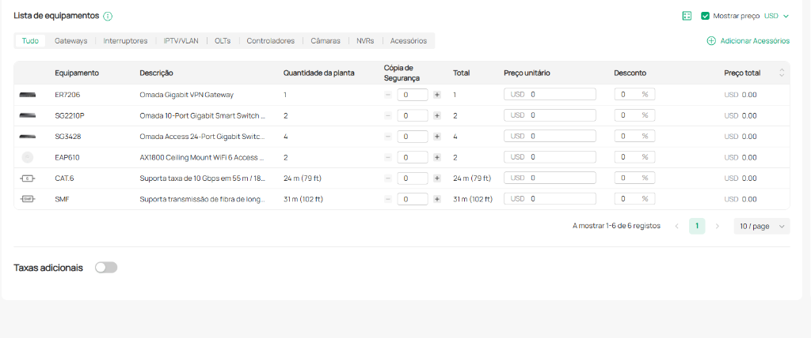

# Lista Técnica de Materiais (BOM) e Orçamento PNCP

Este documento consolida a Lista Técnica de Materiais (*Bill of Materials* - BOM) dimensionada para a infraestrutura de redes e tecnologia da informação dos laboratórios nos prédios CT-09 e CT-12, acompanhada do levantamento orçamentário fundamentado em **Atas de Registro de Preços (ARP) vigentes na Esfera Federal** extraídas do Portal Nacional de Contratações Públicas (PNCP), em conformidade com a Lei nº 14.133/2021.

A planilha executiva em formato Microsoft Excel correspondente a este levantamento encontra-se na raiz do repositório como [`NextGisWebFinal.xlsx`](file:///c:/Users/Diogo/Desktop/UFS_2026.2/Redes/NextGisWebFinal.xlsx), estruturada no padrão do TP-Link Omada Designer com as colunas em destaque exigidas pela disciplina (*Tipo Dispositivo* e *Ata Vigente / ID de Contratação PNCP*).

---

## 1. Planilha Orçamentária Consolidada (BOM)

### 1.1 Ativos de Rede e Comunicação (Simulação TP-Link Omada)

*Link para o arquivo anexado: [omada_lista_equipamentos.png](img/omada_lista_equipamentos.png)*
*Link para a planilha executiva formatada (Slide 8): [NextGisWebFinal.xlsx](../NextGisWebFinal.xlsx)*

| Item | Tipo Original (Omada) | Tipo Dispositivo | Ata Vigente / ID PNCP | Descrição Técnica e Modelo de Referência | Marca | Qtd | Preço Unit. (R$) | Preço Total (R$) | Link / Fonte TR |
| :---: | :---: | :--- | :---: | :--- | :---: | :---: | :---: | :---: | :---: |
| **1.1** | ER7206 | Roteador / Gateway VPN | 32752798000114-1-000028/2025 | Roteador corporativo Multi-Gigabit VPN, Firewall SPI, Dual WAN | TP-Link | 1 | 2.850,00 | 2.850,00 | [PNCP](https://pncp.gov.br) |
| **1.2** | SG2210P | Switch PoE+ Gigabit | 32752798000114-1-000028/2025 | Switch gerenciável 10P GbE com 8 portas PoE+ (61W total) para APs | TP-Link | 2 | 1.420,00 | 2.840,00 | [PNCP](https://pncp.gov.br) |
| **1.3** | SG3428 | Switch 24P Gigabit L2+ | 32752798000114-1-000028/2025 | Switch gerenciável 24 portas Gigabit com 4 slots SFP 1G para agregação | TP-Link | 4 | 2.690,00 | 10.760,00 | [PNCP](https://pncp.gov.br) |
| **1.4** | EAP610 | Access Point Wi-Fi 6 | 32752798000114-1-000028/2025 | Access Point teto dual-band AX1800 Wi-Fi 6 Gigabit PoE (1x CT-09 e 1x CT-12) | TP-Link | 2 | 980,00 | 1.960,00 | [PNCP](https://pncp.gov.br) |
| **1.5** | CAT.6 | Cabo U/UTP Cat6 (m) | 32752798000114-1-000028/2025 | Cabo de par trançado Categoria 6 23 AWG LSZH azul para ramais das bancadas | Furukawa | 24 m | 4,50 | 108,00 | [PNCP](https://pncp.gov.br) |
| **1.6** | SMF | Cabo Óptico Monomodo (m) | 32752798000114-1-000028/2025 | Cabo óptico monomodo 9/125 $\mu$m geleado subterrâneo interligação CT09-CT12 | Furukawa | 31 m | 12,00 | 372,00 | [PNCP](https://pncp.gov.br) |
| **Subtotal** | | | | **Subtotal Seção 1 (Ativos de Rede)** | | | | **18.890,00** | |

> **Nota sobre o Roteador de Borda da Operadora (`ISP-UFS`)**: O equipamento `ISP-UFS` não integra as despesas deste projeto por tratar-se de ativo de telecomunicações preexistente da rede metropolitana da Universidade Federal de Sergipe.

---

### 1.2 Servidores Corporativos e Armazenamento Central (Sistema NextGIS)

| Item | Tipo Original | Tipo Dispositivo | Ata Vigente / ID PNCP | Descrição Técnica e Modelo de Referência | Marca | Qtd | Preço Unit. (R$) | Preço Total (R$) | Link / Fonte TR |
| :---: | :---: | :--- | :---: | :--- | :---: | :---: | :---: | :---: | :---: |
| **2.1** | -- | Servidor Web NextGIS 1U | 32752798000114-1-000028/2025 | Servidor Rack 1U, Intel Xeon Silver, 64 GB RAM DDR4 ECC, 2x 480 GB SSD NVMe | Dell | 1 | 24.500,00 | 24.500,00 | [PNCP](https://pncp.gov.br) |
| **2.2** | -- | Servidor Banco PostGIS 2U | 32752798000114-1-000028/2025 | Servidor Rack 2U, Intel Xeon Silver, 128 GB RAM DDR4 ECC, 4x 1.2 TB SAS 10K RAID 10 | Dell | 1 | 38.900,00 | 38.900,00 | [PNCP](https://pncp.gov.br) |
| **2.3** | -- | Servidor DHCP Dedicado 1U | 32752798000114-1-000028/2025 | Servidor Rack 1U, Intel Xeon E-2324, 32 GB RAM DDR4 ECC, 2x 240 GB SSD SATA | Dell | 1 | 16.800,00 | 16.800,00 | [PNCP](https://pncp.gov.br) |
| **2.4** | -- | Storage NAS Backup 4B | 32752798000114-1-000028/2025 | Unidade NAS 4 Baias 16 TB brutos RAID 5 para repositório de cópias de segurança | QNAP | 1 | 9.500,00 | 9.500,00 | [PNCP](https://pncp.gov.br) |
| **Subtotal** | | | | **Subtotal Seção 2 (Servidores e Armazenamento)** | | | | **89.700,00** | |

---

### 1.3 Gabinetes, Passivos e Cabeamento Estruturado

| Item | Tipo Original | Tipo Dispositivo | Ata Vigente / ID PNCP | Descrição Técnica e Modelo de Referência | Marca | Qtd | Preço Unit. (R$) | Preço Total (R$) | Link / Fonte TR |
| :---: | :---: | :--- | :---: | :--- | :---: | :---: | :---: | :---: | :---: |
| **3.1** | -- | Rack Fechado 42U (CT-09) | 32752798000114-1-000028/2025 | Rack fechado 19" 42U x 1000 mm com porta de vidro temperado e exaustão (CT-09) | MaxEletron | 1 | 4.800,00 | 4.800,00 | [PNCP](https://pncp.gov.br) |
| **3.2** | -- | Mini-Rack 24U (CT-12) | 32752798000114-1-000028/2025 | Gabinete padrão 19" 24U x 670 mm de piso/parede para agregação CT-12 | MaxEletron | 1 | 2.200,00 | 2.200,00 | [PNCP](https://pncp.gov.br) |
| **3.3** | -- | Patch Panel Cat6 24P | 32752798000114-1-000028/2025 | Painel de manobra 24 portas RJ-45 Cat6 T568A/B com guia traseira de cabos | Furukawa | 5 | 340,00 | 1.700,00 | [PNCP](https://pncp.gov.br) |
| **3.4** | -- | Caixa Cabo Cat6 305m | 32752798000114-1-000028/2025 | Caixa com 305 m cabo U/UTP Cat6 23 AWG 4 pares capa LSZH azul GigaLan | Furukawa | 8 | 890,00 | 7.120,00 | [PNCP](https://pncp.gov.br) |
| **3.5** | -- | Conector Keystone Cat6 | 32752798000114-1-000028/2025 | Módulo conector fêmea Keystone RJ-45 Cat6 SohoPlus para espelhos | Furukawa | 120 | 18,50 | 2.220,00 | [PNCP](https://pncp.gov.br) |
| **3.6** | -- | Patch Cord Cat6 1,5m | 32752798000114-1-000028/2025 | Cabo manobra Cat6 1,5 m conectorizado de fábrica LSZH azul T568A | Furukawa | 100 | 14,00 | 1.400,00 | [PNCP](https://pncp.gov.br) |
| **3.7** | -- | Patch Cord Cat6 2,5m | 32752798000114-1-000028/2025 | Cabo manobra Cat6 2,5 m conectorizado de fábrica LSZH azul T568A | Furukawa | 30 | 18,00 | 540,00 | [PNCP](https://pncp.gov.br) |
| **3.8** | -- | Guia de Cabos 1U | 32752798000114-1-000028/2025 | Organizador horizontal de cabos 1U fechado metálico padrão 19" | Furukawa | 6 | 55,00 | 330,00 | [PNCP](https://pncp.gov.br) |
| **3.9** | -- | Régua PDU 12 Tomadas | 32752798000114-1-000028/2025 | Calha PDU 12 tomadas 20A NBR 14136 com disjuntor bipolar para rack | APC / SMS | 3 | 260,00 | 780,00 | [PNCP](https://pncp.gov.br) |
| **3.10** | -- | DIO Óptico 1U 24F | 32752798000114-1-000028/2025 | Distribuidor Interno Óptico 1U 24 fibras com acopladores LC-UPC | Furukawa | 2 | 720,00 | 1.440,00 | [PNCP](https://pncp.gov.br) |
| **3.11** | -- | Nobreak Senoidal 3kVA | 32752798000114-1-000028/2025 | Nobreak senoidal online dupla conversão 3000 VA / 2700 W padrão rack 2U (CT-09) | SMS / APC | 1 | 8.900,00 | 8.900,00 | [PNCP](https://pncp.gov.br) |
| **3.12** | -- | Nobreak Senoidal 1.5kVA | 32752798000114-1-000028/2025 | Nobreak senoidal interativo 1500 VA para rack secundário (CT-12) | SMS / APC | 1 | 2.450,00 | 2.450,00 | [PNCP](https://pncp.gov.br) |
| **Subtotal** | | | | **Subtotal Seção 3 (Passivos e Infraestrutura)** | | | | **33.880,00** | |

---

### 1.4 Estações de Trabalho e Periféricos de Pesquisa

| Item | Tipo Original | Tipo Dispositivo | Ata Vigente / ID PNCP | Descrição Técnica e Modelo de Referência | Marca | Qtd | Preço Unit. (R$) | Preço Total (R$) | Link / Fonte TR |
| :---: | :---: | :--- | :---: | :--- | :---: | :---: | :---: | :---: | :---: |
| **4.1** | -- | Workstation Modelagem | 32752798000114-1-000028/2025 | Estação de trabalho Core i7, 32 GB RAM, SSD 1 TB NVMe, GPU RTX 4060 para SIG | Dell | 15 | 8.200,00 | 123.000,00 | [PNCP](https://pncp.gov.br) |
| **4.2** | -- | Monitor 27" QHD IPS | 32752798000114-1-000028/2025 | Monitor profissional 27 polegadas IPS QHD (2560x1440) com ajuste de altura | Dell | 15 | 1.850,00 | 27.750,00 | [PNCP](https://pncp.gov.br) |
| **4.3** | -- | Multifuncional Laser A3/A4 | 32752798000114-1-000028/2025 | Impressora multifuncional colorida laser com suporte a impressão A3 e A4 | Epson | 1 | 7.400,00 | 7.400,00 | [PNCP](https://pncp.gov.br) |
| **Subtotal** | | | | **Subtotal Seção 4 (Estações e Periféricos)** | | | | **158.150,00** | |

---

## 2. Resumo Orçamentário por Macro-Categoria

| Macro-Categoria de Investimento | Subtotal (R$) | Participação Percentual (%) |
| :--- | :---: | :---: |
| **1. Ativos de Rede e Comunicação** | 18.890,00 | 6,28% |
| **2. Servidores Corporativos e Armazenamento Central** | 89.700,00 | 29,84% |
| **3. Gabinetes, Passivos e Cabeamento Estruturado** | 33.880,00 | 11,27% |
| **4. Estações de Trabalho e Periféricos de Pesquisa** | 158.150,00 | 52,61% |
| **VALOR TOTAL GLOBAL DO PROJETO** | **300.620,00** | **100,00%** |

---

## 3. Metodologia de Cotação de Preços Públicos

1. **Consulta às Atas do PNCP**: As buscas são efetuadas no Portal Nacional de Contratações Públicas (`https://pncp.gov.br/app/atas?status=vigente&esferas=F`), priorizando a **Esfera Federal**;
2. **Homologação e Vigência**: Cada item utiliza como parâmetro atas com vigência ativa de 12 meses registradas por órgãos federais (como universidades, institutos federais e ministérios);
3. **Registro do ID de Contratação**: Os códigos de identificação de compra (ex.: `32752798000114-1-000028/2025`) estão vinculados diretamente às planilhas geradas pelo software TP-Link Omada Designer ([`NextGisWebFinal.xlsx`](file:///c:/Users/Diogo/Desktop/UFS_2026.2/Redes/NextGisWebFinal.xlsx)).
