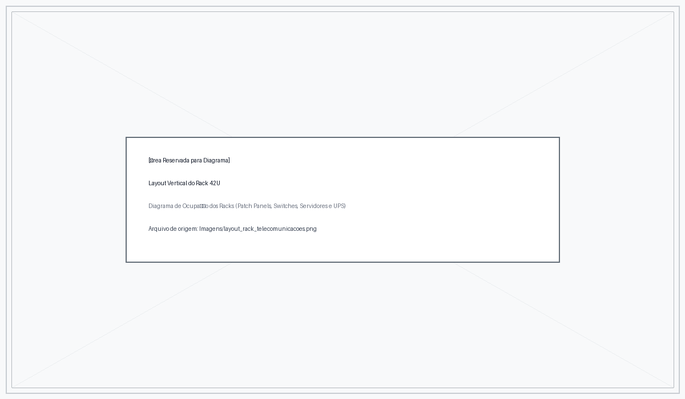

# Diagrama de Ocupação dos Racks de Telecomunicações

Este documento detalha o layout físico e a elevação vertical em escala U dos gabinetes padrão 19 polegadas (norma EIA/ECA-310-E) dimensionados para os laboratórios nos prédios **CT-09 (Sala 101)** e **CT-12 (Sala 201)** da Universidade Federal de Sergipe.

O diagrama textual em formato Markdown abaixo atende rigorosamente ao padrão executivo estabelecido na especificação da disciplina (*Projeto-de-Redes-da-Turma-2026-2.pdf*, Slide 7).

---

## 1. Rack Principal de Telecomunicações e Servidores (42U - CT-09 Sala 101)

* **Gabinete**: Rack fechado de piso autossustentado $42\text{U} \times 800\text{mm} \times 1000\text{mm}$ com porta de vidro temperado fumê e fechadura com chave;
* **Localização**: Laboratório CT-09 (Sala 101), posicionado no canto inferior direito junto à infraestrutura de energia estabilizada;
* **Finalidade**: Concentrar os ativos de borda e segurança, roteamento inter-VLAN, switches de agregação, servidores corporativos do sistema CKAN, armazenamento em rede (NAS) e sistema de alimentação ininterrupta.

### 1.1 Diagrama de Elevação Vertical em Escala U (Markdown Textual)

```text
=============================================================================
                      SISTEMA DE EXAUSTÃO (TETO DO RACK)
=============================================================================
[U42] [======================= PAINEL DE VENTILAÇÃO =======================]
[U41] [=================== CALHA DE TOMADAS (PDU) 12T =====================]
[U40] [=================== ROTEADOR / FIREWALL BORDA (ER7206) =============]
[U39] [----------------- GUIA DE CABO HORIZONTAL 1U -----------------------]
[U38] [=================== FIREWALL PERIMETRAL FÍSICO (ASA 5506-X) ========]
[U37] [----------------- GUIA DE CABO HORIZONTAL 1U -----------------------]
[U36] [=================== ROTEADOR INTERNO INTER-VLAN (CISCO 2911) =======]
[U35] [----------------- GUIA DE CABO HORIZONTAL 1U -----------------------]
[U34] [=================== SWITCH CORE / AGREGAÇÃO (SG3428 24P) ===========]
[U33] [----------------- GUIA DE CABO HORIZONTAL 1U -----------------------]
[U32] [================== PATCH PANEL 01 (DATACENTER CKAN) ================]
[U31] [----------------- GUIA DE CABO HORIZONTAL 1U -----------------------]
[U30] [================== SWITCH DE ACESSO 01 POE+ (SG2210P) ==============]
[U29] [----------------- GUIA DE CABO HORIZONTAL 1U -----------------------]
[U28] [================ PATCH PANEL 02 (ESTRUTURADO CT-09 BLOCO A) ========]
[U27] [----------------- GUIA DE CABO HORIZONTAL 1U -----------------------]
[U26] [================== SWITCH DE ACESSO 02 (SG3428 DADOS) ==============]
[U25] [----------------- GUIA DE CABO HORIZONTAL 1U -----------------------]
[U24] [================ PATCH PANEL 03 (ESTRUTURADO CT-09 BLOCO B) ========]
[U23] [----------------- GUIA DE CABO HORIZONTAL 1U -----------------------]
[U22] [====================== ESPAÇO VAGO / RESERVA ======================]
[U21] [====================== ESPAÇO VAGO / RESERVA ======================]
[U20] [====================== ESPAÇO VAGO / RESERVA ======================]
[U19] [================== DIO (DISTRIBUIDOR INTERNO ÓPTICO 24F) ===========]
[U18] [----------------- GUIA DE CABO HORIZONTAL 1U -----------------------]
[U17] [=================== BANDEJA FIXA DE TI (1U) ========================]
[U16] [====================== ESPAÇO VAGO / RESERVA ======================]
[U15] [======== SERVIDOR DHCP DEDICADO DELL POWEREDGE R250 (1U) ===========]
[U14] [----------------- GUIA DE CABO HORIZONTAL 1U -----------------------]
[U13] [======== SERVIDOR WEB CKAN PORTAL DELL POWEREDGE R440 (1U) =======]
[U12] [----------------- GUIA DE CABO HORIZONTAL 1U -----------------------]
[U11] [  NAS / STORAGE BACKUP 4 BAIAS 16TB RAID 5 (QNAP)                   ] (2U)
[U10] [____________________________________________________________________]
[U09] [  SERVIDOR BANCO POSTGIS DELL POWEREDGE R540 2U (128GB/SAS)         ] (2U)
[U08] [____________________________________________________________________]
[U07] [====================== ESPAÇO VAGO / RESERVA ======================]
[U06] [====================== ESPAÇO VAGO / RESERVA ======================]
[U05] [====================== ESPAÇO VAGO / RESERVA ======================]
[U04] [  BANCO DE BATERIAS EXTERNO (EXPANSÃO DE AUTONOMIA 2U)              ] (2U)
[U03] [____________________________________________________________________]
[U02] [  NO-BREAK (UPS) SENOIDAL ONLINE DUPLA CONVERSÃO 3000VA (2U)        ] (2U)
[U01] [____________________________________________________________________]
=============================================================================
                           BASE DO RACK / RODÍZIOS
=============================================================================
::: ORGANIZADORES LATERAIS :::
(Passam verticalmente da base ao topo nas laterais esquerda e direita)
```


*Link para o anexo em alta resolução: [layout_rack_telecomunicacoes.png](img/layout_rack_telecomunicacoes.png)*

---

## 2. Rack Secundário de Distribuição Local (24U - CT-12 Sala 201)

* **Gabinete**: Mini-Rack padrão 19" $24\text{U} \times 600\text{mm} \times 670\text{mm}$ de piso/parede com porta de vidro e fechadura;
* **Localização**: Laboratório CT-12 (Sala 201), posicionado no canto superior direito;
* **Finalidade**: Realizar a terminação do enlace óptico do campus, comutação local dos postos de trabalho e alimentação PoE do Access Point EAP610.

### 2.1 Diagrama de Elevação Vertical em Escala U (Markdown Textual)

```text
=============================================================================
                      SISTEMA DE VENTILAÇÃO (TETO DO RACK)
=============================================================================
[U24] [======================= PAINEL DE VENTILAÇÃO =======================]
[U23] [=================== CALHA DE TOMADAS (PDU) 8T ======================]
[U22] [================== DIO (DISTRIBUIDOR INTERNO ÓPTICO 24F) ===========]
[U21] [----------------- GUIA DE CABO HORIZONTAL 1U -----------------------]
[U20] [================= SWITCH DE ACESSO 01 (SG3428 24P GBE) =============]
[U19] [----------------- GUIA DE CABO HORIZONTAL 1U -----------------------]
[U18] [================ PATCH PANEL 01 (ESTRUTURADO CT-12 BLOCO A) ========]
[U17] [----------------- GUIA DE CABO HORIZONTAL 1U -----------------------]
[U16] [================= SWITCH DE ACESSO 02 (SG3428 24P GBE) =============]
[U15] [----------------- GUIA DE CABO HORIZONTAL 1U -----------------------]
[U14] [================ PATCH PANEL 02 (ESTRUTURADO CT-12 BLOCO B) ========]
[U13] [----------------- GUIA DE CABO HORIZONTAL 1U -----------------------]
[U12] [================== SWITCH DE ACESSO 03 POE+ (SG2210P) ==============]
[U11] [----------------- GUIA DE CABO HORIZONTAL 1U -----------------------]
[U10] [=================== BANDEJA FIXA DE APOIO (1U) =====================]
[U09] [====================== ESPAÇO VAGO / RESERVA ======================]
[U08] [====================== ESPAÇO VAGO / RESERVA ======================]
[U07] [====================== ESPAÇO VAGO / RESERVA ======================]
[U06] [====================== ESPAÇO VAGO / RESERVA ======================]
[U05] [====================== ESPAÇO VAGO / RESERVA ======================]
[U04] [====================== ESPAÇO VAGO / RESERVA ======================]
[U03] [====================== ESPAÇO VAGO / RESERVA ======================]
[U02] [  NO-BREAK (UPS) SENOIDAL INTERATIVO 1500VA RACKMOUNT (2U)           ] (2U)
[U01] [____________________________________________________________________]
=============================================================================
                           BASE DO RACK / FIXAÇÃO
=============================================================================
::: ORGANIZADORES LATERAIS DE CABOS :::
```

---

## 3. Critérios Técnicos de Engenharia e Boas Práticas

1. **Distribuição Gravitacional de Cargas**:
   * O sistema de nobreak e os módulos de baterias (elementos mais pesados do conjunto, totalizando mais de 60 kg) foram alocados na base inferior ([U01] a [U04]) para rebaixar o centro de gravidade e prevenir instabilidades estruturais do gabinete;
   * Os servidores de processamento e armazenamento (Dell PowerEdge e QNAP) ocupam o terço médio inferior ([U08] a [U15]);
   * Equipamentos ativos de rede leves e painéis de manobra ocupam a porção superior ([U24] a [U42]).

2. **Termodinâmica e Fluxo de Ar (*Airflow*)**:
   * Todos os equipamentos adotam o padrão de refrigeração frontal-traseira (*Front-to-Back Airflow*);
   * Os espaços vagos foram reservados para evitar acúmulo de ar quente residual entre as lâminas de processamento;
   * O topo do gabinete é equipado com sistema de exaustão forçada com 4 ventiladores acionados por termostato regulado para $24^\circ\text{C}$.

3. **Gerenciamento e Manutenibilidade de Cabos**:
   * Aplicação rigorosa da regra 1:1 (um organizador horizontal de cabos 1U para cada elemento de manobra ou ativo comutador);
   * Manobras estruturadas com cordões de tamanho padronizado (0,5 m e 1,5 m), eliminando laços suspensos e obstrução visual das portas de diagnóstico.
