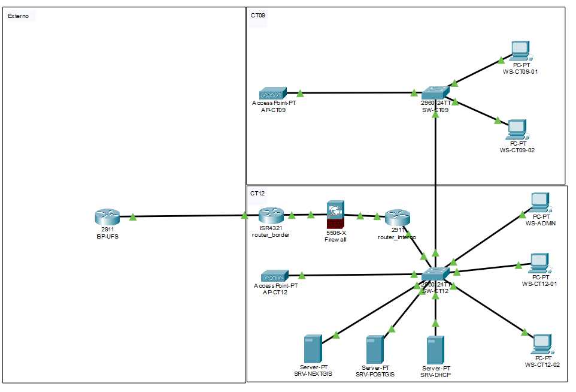

# Guia Prático de Montagem no Cisco Packet Tracer (v9.0.1)

**Projeto**: Infraestrutura de Rede Local - Grupo de Pesquisa em Modelagem Hidrológica (UFS)  
**Topologia**: Modelo Canônico Inter-Prédios (CT-09 e CT-12) com Provedor ISP-UFS, Borda ISR4321, Firewall ASA 5506-X, Núcleo 2911 e DHCP Dedicado  
**Software**: Cisco Packet Tracer 9.0.1 (Windows 64-bit)  

---

## 1. Dispositivos e Modelos no Cisco Packet Tracer

Para montar a topologia canônica no espaço de trabalho (*workspace*), selecione os seguintes dispositivos na barra inferior do simulador:

| Dispositivo Lógico | Categoria no Packet Tracer | Modelo Exato | Nome de Exibição (*Display Name*) |
| :--- | :--- | :--- | :--- |
| **Provedor WAN / Internet** | *Network Devices* $\rightarrow$ *Routers* | **Cisco 2911** (ou 1941) | `ISP-UFS` |
| **Roteador de Borda** | *Network Devices* $\rightarrow$ *Routers* | **Cisco ISR4321** | `router_border` |
| **Firewall Físico** | *Network Devices* $\rightarrow$ *Security* | **Cisco ASA 5506-X** | `firewall_asa` |
| **Roteador Interno** | *Network Devices* $\rightarrow$ *Routers* | **Cisco 2911** | `router_interno` |
| **Switch Prédio CT-12** | *Network Devices* $\rightarrow$ *Switches* | **Cisco Catalyst 2960-24TT** | `SW-CT12` |
| **Switch Prédio CT-09** | *Network Devices* $\rightarrow$ *Switches* | **Cisco Catalyst 2960-24TT** | `SW-CT09` |
| **Servidor CKAN Portal** | *End Devices* $\rightarrow$ *End Devices* | **Server-PT** | `SRV-CKAN` |
| **Servidor PostGIS DB** | *End Devices* $\rightarrow$ *End Devices* | **Server-PT** | `SRV-POSTGIS` |
| **Servidor DHCP Dedicado** | *End Devices* $\rightarrow$ *End Devices* | **Server-PT** | `SRV-DHCP` |
| **Estação Gerência** | *End Devices* $\rightarrow$ *End Devices* | **PC-PT** | `WS-ADMIN` |
| **Estações Pesquisa CT-12** | *End Devices* $\rightarrow$ *End Devices* | **PC-PT** (2 unidades) | `WS-CT12-01`, `WS-CT12-02` |
| **Estações Pesquisa CT-09** | *End Devices* $\rightarrow$ *End Devices* | **PC-PT** (2 unidades) | `WS-CT09-01`, `WS-CT09-02` |
| **Access Points Sem Fio** | *Network Devices* $\rightarrow$ *Wireless Devices* | **Access Point-PT** (2 unidades) | `AP-CT12`, `AP-CT09` |

---

## 2. Diagrama da Topologia no Workspace


*Link para o arquivo anexado em alta resolução: [topologia_logica.png](img/topologia_logica.png)*
*Arquivo de simulação executável: [topologia_1.pkt](../packer-tracker/topologia/topologia_1.pkt)*

Disponha os elementos na tela organizados por blocos lógicos:

```
       ======================== BLOCO EXTERNO ========================
                      +-----------------------------+
                      |     ISP-UFS (Cisco 2911)    |
                      |   g0/0: 200.17.0.1/30       |
                      |   Loopback0: 8.8.8.8/32     |
                      +--------------+--------------+
                                     | Cabo Direto (GbE) - Enlace WAN 200.17.0.0/30
                                     v
       ===================== PRÉDIO CT-12 (SALA 201) =====================
                      +-----------------------------+
                      |    router_border (ISR4321)  |
                      |   g0/0/1: 200.17.0.2/30     |
                      |   g0/0/0: 10.0.0.1/30 (NAT) |
                      +--------------+--------------+
                                     | Cabo Direto (GbE) - Enlace P2P 10.0.0.0/30
                                     v
                      +-----------------------------+
                      |   firewall_asa (ASA 5506-X) |
                      |   g1/1 (Outside): 10.0.0.2  |
                      |   g1/2 (Inside):  10.0.1.1  |
                      +--------------+--------------+
                                     | Cabo Direto (GbE) - Enlace P2P 10.0.1.0/30
                                     v
                      +-----------------------------+
                      |    router_interno (2911)    |
                      |   g0/1: 10.0.1.2/30         |
                      |   g0/0: Tronco 802.1Q       |
                      |   - g0/0.10: 192.168.10.1   |
                      |   - g0/0.20: 192.168.20.1   |
                      |   - g0/0.30: 192.168.30.1   |
                      |   - g0/0.40: 192.168.40.1   |
                      +--------------+--------------+
                                     | Cabo Direto (Tronco 802.1Q)
                                     v
                      +-----------------------------+
                      |    SW-CT12 (Cisco 2960)     |
                      |   VLAN 10 SVI: .10.2        |
                      +------+-------+-------+------+
                             |       |       |      |
            +----------------+       |       |      +-----------------+
            | (VLAN 20)              | (VLAN 30)   | (VLAN 40)       | (Tronco 802.1Q)
            v                        v             v                 v (Backbone Óptico)
    [Servidores DMZ]            [Estações CT-12]  [AP CT-12]   [Para SW-CT09]
    - CKAN Portal (.20.10)      - WS-CT12-01 (DHCP) (Wi-Fi)           |
    - PostGIS DB (.20.20)       - WS-CT12-02 (DHCP)                   |
    - SRV-DHCP (.20.30)         - WS-ADMIN (.30.10)                   |
                                                                      v
       ===================== PRÉDIO CT-09 (SALA 101) =====================
                                            +-----------------------------+
                                            |    SW-CT09 (Cisco 2960)     |
                                            |   VLAN 10 SVI: .10.3        |
                                            +--------------+--------------+
                                                           |
                                      +--------------------+--------------------+
                                      | (VLAN 30)                               | (VLAN 40)
                                      v                                         v
                              [Estações CT-09]                              [AP CT-09]
                              - WS-CT09-01 (DHCP)                           (Wi-Fi)
                              - WS-CT09-02 (DHCP)
```

---

## 3. Guia de Cabeamento Físico

Selecione a ferramenta de cabos (*Connections* $\rightarrow$ *Copper Straight-Through* / Cabo Par Trançado Direto) e conecte as portas conforme a tabela:

| Dispositivo Origem | Porta Origem | Dispositivo Destino | Porta Destino | Função / Segmento |
| :--- | :--- | :--- | :--- | :--- |
| `ISP-UFS` | `GigabitEthernet0/0` | `router_border` | `GigabitEthernet0/0/1` | Enlace WAN Provedor UFS (200.17.0.0/30) |
| `router_border` | `GigabitEthernet0/0/0` | `firewall_asa` | `GigabitEthernet1/1` | Enlace P2P Borda-ASA Outside (10.0.0.0/30) |
| `firewall_asa` | `GigabitEthernet1/2` | `router_interno` | `GigabitEthernet0/1` | Enlace P2P ASA Inside-Núcleo (10.0.1.0/30) |
| `router_interno` | `GigabitEthernet0/0` | `SW-CT12` | `GigabitEthernet0/1` | Tronco 802.1Q (Router-on-a-Stick) |
| `SW-CT12` | `GigabitEthernet0/2` | `SW-CT09` | `GigabitEthernet0/2` | Tronco 802.1Q (Backbone Campus) |
| `SW-CT12` | `FastEthernet0/1` | `SRV-CKAN` | `FastEthernet0` | DMZ Servidores - VLAN 20 |
| `SW-CT12` | `FastEthernet0/2` | `SRV-POSTGIS` | `FastEthernet0` | DMZ Servidores - VLAN 20 |
| `SW-CT12` | `FastEthernet0/3` | `SRV-DHCP` | `FastEthernet0` | Servidor DHCP Dedicado - VLAN 20 |
| `SW-CT12` | `FastEthernet0/4` | `WS-ADMIN` | `FastEthernet0` | Estação Gerência - VLAN 30 |
| `SW-CT12` | `FastEthernet0/5` | `WS-CT12-01` | `FastEthernet0` | Pesquisa CT-12 - VLAN 30 (DHCP) |
| `SW-CT12` | `FastEthernet0/6` | `WS-CT12-02` | `FastEthernet0` | Pesquisa CT-12 - VLAN 30 (DHCP) |
| `SW-CT12` | `FastEthernet0/7` | `AP-CT12` | `Port 0` | Rede Sem Fio - VLAN 40 |
| `SW-CT09` | `FastEthernet0/1` | `WS-CT09-01` | `FastEthernet0` | Pesquisa CT-09 - VLAN 30 (DHCP) |
| `SW-CT09` | `FastEthernet0/2` | `WS-CT09-02` | `FastEthernet0` | Pesquisa CT-09 - VLAN 30 (DHCP) |
| `SW-CT09` | `FastEthernet0/3` | `AP-CT09` | `Port 0` | Rede Sem Fio - VLAN 40 |

---

## 4. Roteiro de Configuração via CLI

### 4.1 Provedor de Internet / Backbone WAN (`ISP-UFS` - Cisco 2911 / 1941)

Abra o equipamento `ISP-UFS`, acesse a aba **CLI** e execute:

```bash
enable
configure terminal
hostname ISP-UFS

! Interface WAN voltada ao router_border do laboratorio
interface GigabitEthernet0/0
 description ENLACE_COM_ROUTER_BORDER
 ip address 200.17.0.1 255.255.255.252
 no shutdown
 exit

! Interface virtual simulando a Internet pública e Servidor DNS
interface Loopback0
 description INTERNET_PUBLICA_DNS_GOOGLE
 ip address 8.8.8.8 255.255.255.255
 no shutdown
 exit

! Rota de retorno para a sub-rede publica do laboratorio
ip route 200.17.0.0 255.255.255.252 200.17.0.2

end
write memory
```

---

### 4.2 Roteador de Borda (`router_border` - Cisco ISR 4321)

Abra o equipamento `router_border`, acesse a aba **CLI** e execute:

```bash
enable
configure terminal
hostname router_border

! Interface WAN (conectada ao ISP-UFS)
interface GigabitEthernet0/0/1
 description CONEXAO_CAMPUS_UFS
 ip address 200.17.0.2 255.255.255.252
 ip nat outside
 no shutdown
 exit

! Interface LAN P2P de Transito com firewall_asa
interface GigabitEthernet0/0/0
 description TRANSITO_FIREWALL_ASA
 ip address 10.0.0.1 255.255.255.252
 ip nat inside
 no shutdown
 exit

! Rotas Estaticas
ip route 0.0.0.0 0.0.0.0 200.17.0.1
ip route 192.168.0.0 255.255.0.0 10.0.0.2
ip route 10.0.1.0 255.255.255.252 10.0.0.2

! Configuracao de NAT/PAT
access-list 1 permit 192.168.0.0 0.0.255.255
ip nat inside source list 1 interface GigabitEthernet0/0/1 overload

end
write memory
```

---

### 4.3 Firewall Físico (`firewall_asa` - Cisco ASA 5506-X)

Abra o equipamento `firewall_asa`, acesse a aba **CLI**, pressione Enter e execute:

```bash
enable
! (Pressione Enter em branco na senha)
configure terminal
hostname ASA-5506

! Interface Externa (Outside)
interface GigabitEthernet1/1
 description CONEXAO_ROUTER_BORDER_WAN
 nameif outside
 security-level 0
 ip address 10.0.0.2 255.255.255.252
 no shutdown
 exit

! Interface Interna (Inside)
interface GigabitEthernet1/2
 description CONEXAO_ROUTER_INTERNO_LAN
 nameif inside
 security-level 100
 ip address 10.0.1.1 255.255.255.252
 no shutdown
 exit

! Rotas Estaticas
route outside 0.0.0.0 0.0.0.0 10.0.0.1 1
route inside 192.168.0.0 255.255.0.0 10.0.1.2 1

! Inspecao de Estado Modular (MPF)
policy-map global_policy
 class inspection_default
  inspect icmp
  inspect http
  inspect dns
 exit

service-policy global_policy global

! Regras de ACL para permitir resposta ICMP
access-list OUTSIDE_IN extended permit icmp any any echo-reply
access-list OUTSIDE_IN extended permit icmp any any unreachable
access-list OUTSIDE_IN extended permit icmp any any time-exceeded
access-group OUTSIDE_IN in interface outside

write memory
```

---

### 4.4 Roteador Interno (`router_interno` - Cisco 2911)

Abra o equipamento `router_interno`, acesse a aba **CLI** e execute:

```bash
enable
configure terminal
hostname router_interno

! Interface de Transito com firewall_asa
interface GigabitEthernet0/1
 description TRANSITO_FIREWALL_ASA
 ip address 10.0.1.2 255.255.255.252
 no shutdown
 exit

! Rota Padrao direcionada ao Firewall ASA
ip route 0.0.0.0 0.0.0.0 10.0.1.1

! Interface Tronco L3 (Router-on-a-Stick)
interface GigabitEthernet0/0
 no ip address
 no shutdown
 exit

! Subinterfaces 802.1Q
interface GigabitEthernet0/0.10
 encapsulation dot1Q 10
 ip address 192.168.10.1 255.255.255.0
 no shutdown
 exit

interface GigabitEthernet0/0.20
 encapsulation dot1Q 20
 ip address 192.168.20.1 255.255.255.0
 no shutdown
 exit

interface GigabitEthernet0/0.30
 encapsulation dot1Q 30
 ip address 192.168.30.1 255.255.255.0
 ip helper-address 192.168.20.30
 ip access-group ACL_PESQUISA_IN in
 no shutdown
 exit

interface GigabitEthernet0/0.40
 encapsulation dot1Q 40
 ip address 192.168.40.1 255.255.255.0
 ip helper-address 192.168.20.30
 ip access-group ACL_WIFI_IN in
 no shutdown
 exit

! Remove pools locais caso existam
no ip dhcp pool POOL_PESQUISA
no ip dhcp pool POOL_WIFI

! Listas de Controle de Acesso (ACLs)
ip access-list extended ACL_PESQUISA_IN
 permit udp any any eq bootpc
 permit udp any any eq bootps
 permit tcp 192.168.30.0 0.0.255.255 host 192.168.20.10 eq 80
 permit tcp 192.168.30.0 0.0.255.255 host 192.168.20.10 eq 443
 deny tcp 192.168.30.0 0.0.255.255 host 192.168.20.20 eq 5432
 permit tcp host 192.168.30.10 192.168.10.0 0.0.0.255 eq 22
 deny ip 192.168.30.0 0.0.255.255 192.168.10.0 0.0.0.255
 permit ip 192.168.30.0 0.0.255.255 any
 exit

ip access-list extended ACL_WIFI_IN
 permit udp any any eq bootpc
 permit udp any any eq bootps
 permit tcp 192.168.40.0 0.0.255.255 host 192.168.20.10 eq 80
 permit tcp 192.168.40.0 0.0.255.255 host 192.168.20.10 eq 443
 deny ip 192.168.40.0 0.0.255.255 192.168.10.0 0.0.0.255
 deny ip 192.168.40.0 0.0.255.255 192.168.20.0 0.0.0.255
 deny ip 192.168.40.0 0.0.255.255 192.168.30.0 0.0.0.255
 permit ip 192.168.40.0 0.0.255.255 any
 exit

end
write memory
```

---

### 4.5 Switch Prédio CT-12 (`SW-CT12` - Cisco Catalyst 2960-24TT)

Abra o switch `SW-CT12`, acesse a aba **CLI** e execute:

```bash
enable
configure terminal
hostname SW-CT12

! Criacao das VLANs
vlan 10
 name GERENCIA
vlan 20
 name SERVIDORES_DMZ
vlan 30
 name PESQUISADORES
vlan 40
 name WIFI
exit

! IP de Gerencia
interface vlan 10
 ip address 192.168.10.2 255.255.255.0
 no shutdown
 exit
ip default-gateway 192.168.10.1

! Portas Tronco 802.1Q
interface range GigabitEthernet0/1 - 2
 switchport mode trunk
 switchport trunk allowed vlan 10,20,30,40
 no shutdown
 exit

! Portas dos Servidores da DMZ (VLAN 20)
interface range FastEthernet0/1 - 3
 switchport mode access
 switchport access vlan 20
 spanning-tree portfast
 no shutdown
 exit

! Portas das Estacoes (VLAN 30)
interface range FastEthernet0/4 - 6
 switchport mode access
 switchport access vlan 30
 spanning-tree portfast
 no shutdown
 exit

! Porta do Access Point CT-12 (VLAN 40)
interface FastEthernet0/7
 switchport mode access
 switchport access vlan 40
 spanning-tree portfast
 no shutdown
 exit

end
write memory
```

---

### 4.6 Switch Prédio CT-09 (`SW-CT09` - Cisco Catalyst 2960-24TT)

Abra o switch `SW-CT09`, acesse a aba **CLI** e execute:

```bash
enable
configure terminal
hostname SW-CT09

vlan 10
 name GERENCIA
vlan 20
 name SERVIDORES_DMZ
vlan 30
 name PESQUISADORES
vlan 40
 name WIFI
exit

interface vlan 10
 ip address 192.168.10.3 255.255.255.0
 no shutdown
 exit
ip default-gateway 192.168.10.1

! Porta Tronco vinda do CT-12
interface GigabitEthernet0/2
 switchport mode trunk
 switchport trunk allowed vlan 10,20,30,40
 no shutdown
 exit

! Portas das Estacoes de Pesquisa CT-09 (VLAN 30)
interface range FastEthernet0/1 - 2
 switchport mode access
 switchport access vlan 30
 spanning-tree portfast
 no shutdown
 exit

! Porta do Access Point CT-09 (VLAN 40)
interface FastEthernet0/3
 switchport mode access
 switchport access vlan 40
 spanning-tree portfast
 no shutdown
 exit

end
write memory
```

---

## 5. Configuração dos Servidores e Estações

### 5.1 Servidor DHCP Dedicado (`SRV-DHCP`)
1. **Configuração de IP (Desktop $\rightarrow$ IP Configuration)**:
   * IP: `192.168.20.30`, Máscara: `255.255.255.0`, Gateway: `192.168.20.1`, DNS: `8.8.8.8`.
2. **Serviço DHCP (Services $\rightarrow$ DHCP)**:
   * Marque **Service: On**;
   * **Pool Pesquisa**: Pool Name `POOL_PESQUISA`, Gateway `192.168.30.1`, DNS `8.8.8.8`, Start IP `192.168.30.50`, Mask `255.255.255.0`, Max: `50` $\rightarrow$ Clique em **Add**;
   * **Pool Wi-Fi**: Pool Name `POOL_WIFI`, Gateway `192.168.40.1`, DNS `8.8.8.8`, Start IP `192.168.40.50`, Mask `255.255.255.0`, Max: `50` $\rightarrow$ Clique em **Add**;
   * Clique em **Save**.

### 5.2 Servidores Web e Banco de Dados
1. **`SRV-CKAN`**: IP `192.168.20.10`, Máscara `255.255.255.0`, Gateway `192.168.20.1`, DNS `8.8.8.8`. Services $\rightarrow$ HTTP: **On**;
2. **`SRV-POSTGIS`**: IP `192.168.20.20`, Máscara `255.255.255.0`, Gateway `192.168.20.1`, DNS `8.8.8.8`.

### 5.3 Estações de Trabalho
1. **`WS-ADMIN`**: IP `192.168.30.10`, Máscara `255.255.255.0`, Gateway `192.168.30.1`, DNS `8.8.8.8`;
2. **`WS-CT12-01`, `WS-CT12-02`, `WS-CT09-01`, `WS-CT09-02`**: Selecione **DHCP** $\rightarrow$ Recebem IPs dinâmicos `192.168.30.50+` com sucesso.

---

## 6. Procedimento de Teste e Validação Fim a Fim

Abra o **Command Prompt** na estação de trabalho **`WS-CT12-01`**:

1. **Teste do Gateway Local**:
   ```bash
   ping 192.168.30.1
   ```
   *Resultado*: `Reply from 192.168.30.1: bytes=32 time<1ms TTL=255` (0% de perda).

2. **Teste do Servidor DHCP Dedicado**:
   ```bash
   ping 192.168.20.30
   ```
   *Resultado*: Comunicação plena entre a VLAN 30 e a VLAN 20.

3. **Teste da Aplicação Web CKAN**:
   ```bash
   ping 192.168.20.10
   ```
   *Resultado*: Resposta com `TTL=127`. No **Web Browser**, `http://192.168.20.10` carrega a página com sucesso.

4. **Teste de Isolamento da Gerência (ACL Deny)**:
   ```bash
   ping 192.168.10.2
   ```
   *Resultado*: `Reply from 192.168.30.1: Destination host unreachable` (comprovando o bloqueio da VLAN 10).

5. **Teste de Saída WAN (Gateway do Provedor)**:
   ```bash
   ping 200.17.0.1
   ```
   *Resultado*: `Reply from 200.17.0.1: bytes=32 time<1ms TTL=252` (comprovando o trânsito pelo ASA e roteador de borda).

6. **Teste de Conectividade com a Internet Pública (DNS Google)**:
   ```bash
   ping 8.8.8.8
   ```
   *Resultado*: `Reply from 8.8.8.8: bytes=32 time<1ms TTL=252` (comprovando a tradução NAT/PAT e saída plena para a Internet).
