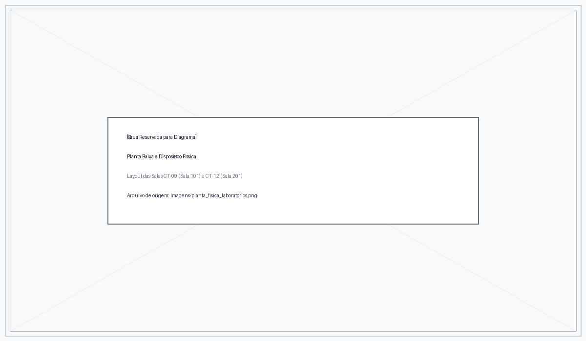

# Projeto Físico da Rede e Cabeamento Estruturado

Este documento descreve o projeto físico de infraestrutura, subsistemas de cabeamento estruturado, encaminhamento de eletrocalhas, planta baixa e o diagrama de ocupação vertical do Rack Principal de telecomunicações.

---

## 1. Subsistemas de Cabeamento Estruturado

A instalação física abrange os prédios **CT-09 (Sala 101 - Bancadas dos Pesquisadores)** e **CT-12 (Sala 201 - Laboratório de Geoprocessamento e Sala de Servidores)**, estruturando-se em cinco subsistemas:

1. **Área de Trabalho (*Work Area*)**:
   * Tomadas modulares com conectores fêmea Keystone RJ-45 Categoria 6 (250 MHz) embutidos nas calhas do mobiliário técnico;
   * Cordões de manobra (*patch cords*) conectorizados de fábrica com botas injetadas de alívio mecânico e condutores 24 AWG (1,5 m nas bancadas e 2,5 m para pontos de piso);
   * Caixas de sobrepor em teto para alimentação dos pontos de acesso Wi-Fi 6 via tecnologia PoE+ (IEEE 802.3at).

2. **Cabeamento Horizontal (*Horizontal Cabling*)**:
   * Cabos de par trançado de 4 pares não blindados (U/UTP) Categoria 6, condutores 23 AWG 100% cobre e capa com baixa emissão de fumaça e livre de halogênios (LSZH);
   * Enlace permanente (*Permanent Link*) rigorosamente limitado a 90 metros, reservando a margem de 10 metros para manobras de patch cords, respeitando o canal total de 100 metros.

3. **Infraestrutura de Encaminhamento de Cabos**:
   * Desativação total das canaletas plásticas sobrepostas antigas;
   * Instalação de eletrocalhas metálicas perfuradas suspensas e calhas técnicas embutidas no mobiliário dos laboratórios;
   * Separação física mínima de 20 cm em relação aos circuitos elétricos de potência para prevenção de interferência eletromagnética (EMI).

4. **Backbone de Campus em Fibra Óptica**:
   * Interligação inter-predial subterrânea entre o Prédio CT-09 e o Prédio CT-12 através de cabo óptico monomodo (*Single-Mode Fiber* - SMF) 9/125 $\mu$m com 6 fibras e proteção mecânica contra umidade e roedores;
   * Terminação em Distribuidores Internos Ópticos (DIO) padrão 19" 1U com conectores LC-UPC e transceivers SFP Gigabit Ethernet 1000BASE-LX.

5. **Salas de Telecomunicações e Gabinetes de Equipamentos**:
   * **Rack Principal (CT-12 Sala 201)**: Gabinete de piso padrão 19" $42\text{U} \times 800\text{mm} \times 1000\text{mm}$ com porta de vidro temperado e exaustão forçada;
   * **Rack Secundário (CT-09 Sala 101)**: Gabinete padrão 19" $24\text{U} \times 600\text{mm} \times 670\text{mm}$.

---

## 2. Planta Baixa de Infraestrutura e Lançamento de Cabos

O trajeto dos condutos, localização do rack e distribuição dos pontos de rede nos dois laboratórios é representado na planta física executiva:



### Quantitativo de Pontos por Sala

| Edifício / Sala | Finalidade Operacional | Tipo do Ponto | Quantidade |
| :--- | :--- | :--- | :---: |
| **CT-09 (Sala 101)** | Bancadas dos Pesquisadores | Keystone RJ-45 Cat6 em mobiliário | 49 |
| **CT-09 (Sala 101)** | Rede Sem Fio (Ponto 901) | Caixa de teto RJ-45 Cat6 PoE+ | 1 |
| **CT-12 (Sala 201)** | Laboratório de Geoprocessamento | Keystone RJ-45 Cat6 em mobiliário | 48 |
| **CT-12 (Sala 201)** | Rede Sem Fio (1201 e WF01) | Caixas de teto RJ-45 Cat6 PoE+ | 2 |
| **Enlace Inter-prédios**| Interligação CT-09 ao CT-12 | Fibra Óptica Monomodo 6FO | 300 m |

---

## 3. Layout e Diagrama de Ocupação Vertical do Rack (42U)

O Rack Principal de 42U localizado na Sala 201 do CT-12 concentra todos os equipamentos ativos e servidores de processamento e dados:


### Diagrama de Elevação Vertical em Escala U (Padrão Executivo)

```text
=============================================================================
                      SISTEMA DE EXAUSTÃO (TETO DO RACK)
=============================================================================
[U42] [=================== DIO ÓPTICO FURUKAWA 1U (CAMPUS) ===================]
[U41] [----------------- GUIA DE CABO HORIZONTAL 1U -------------------------]
[U40] [============== ROTEADOR DE BORDA CISCO ISR 4321 ======================]
[U39] [----------------- GUIA DE CABO HORIZONTAL 1U -------------------------]
[U38] [================ FIREWALL CISCO ASA 5506-X 1U ========================]
[U37] [----------------- GUIA DE CABO HORIZONTAL 1U -------------------------]
[U36] [============== ROTEADOR INTERNO CISCO 2911 ===========================]
[U35] [----------------- GUIA DE CABO HORIZONTAL 1U -------------------------]
[U34] [============= SWITCH CENTRAL CISCO CATALYST 2960 =====================]
[U33] [----------------- GUIA DE CABO HORIZONTAL 1U -------------------------]
[U32] [================ PATCH PANEL CAT6 24P (PAINEL 01) ====================]
[U31] [----------------- GUIA DE CABO HORIZONTAL 1U -------------------------]
[U30] [================ PATCH PANEL CAT6 24P (PAINEL 02) ====================]
[U29] [----------------- GUIA DE CABO HORIZONTAL 1U -------------------------]
[U28] [================ PATCH PANEL CAT6 24P (PAINEL 03) ====================]
[U27] [============== SWITCH POE+ TP-LINK OMADA SG2210P =====================]
[U26] [----------------- GUIA DE CABO HORIZONTAL 1U -------------------------]
[U25] [====================== ESPAÇO VAGO / RESERVA ==========================]
[U24] [====================== ESPAÇO VAGO / RESERVA ==========================]
[U23] [======== SERVIDOR DHCP DEDICADO DELL POWEREDGE R250/R350 1U ==========]
[U22] [----------------- GUIA DE CABO HORIZONTAL 1U -------------------------]
[U21] [                                                                      ] (2U)
[U20] [======== SERVIDOR WEB NEXTGIS DELL POWEREDGE R440 / R450 1U ==========]
[U19] [----------------- GUIA DE CABO HORIZONTAL 1U -------------------------]
[U18] [                                                                      ] (2U)
[U17] [======== SERVIDOR BANCO POSTGIS DELL POWEREDGE R540 / R550 2U ========]
[U16] [                                                                      ]
[U15] [----------------- GUIA DE CABO HORIZONTAL 1U -------------------------]
[U14] [======== STORAGE NAS BACKUP EXTERNO 4 BAIAS RAID 5 ===================] (2U)
[U13] [                                                                      ]
[U12] [====================== BANDEJA FIXA 1U ===============================]
[U11] [====================== ESPAÇO VAGO / RESERVA ==========================]
[U10] [====================== ESPAÇO VAGO / RESERVA ==========================]
[U09] [====================== ESPAÇO VAGO / RESERVA ==========================]
[U08] [====================== ESPAÇO VAGO / RESERVA ==========================]
[U07] [====================== ESPAÇO VAGO / RESERVA ==========================]
[U06] [====================== ESPAÇO VAGO / RESERVA ==========================]
[U05] [====================== ESPAÇO VAGO / RESERVA ==========================]
[U04] [                                                                      ] (4U)
[U03] [======== NOBREAK SENOIDAL ONLINE DUPLA CONVERSÃO 3000VA 2U ===========]
[U02] [======== BANCO DE BATERIAS EXTERNO 2U ================================]
[U01] [                                                                      ]
=============================================================================
                          BASE DO RACK / RODÍZIOS
=============================================================================
::: RÉGUA DE TOMADAS PDU 12 TOMADAS 20A INSTALADA NA LATERAL DO RACK :::
::: ORGANIZADORES VERTICAIS DE CABOS EM AMBAS AS LATERAIS :::
```

> **Nota sobre o Roteador Provedor (`ISP-UFS`)**: Conforme demarcado no projeto lógico, o roteador `ISP-UFS` situa-se no datacenter institucional do Núcleo de Tecnologia da Informação (NTI/UFS), não ocupando espaço físico no rack local do laboratório.
