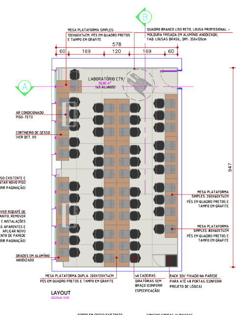
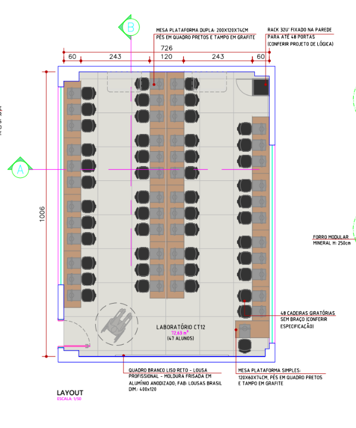
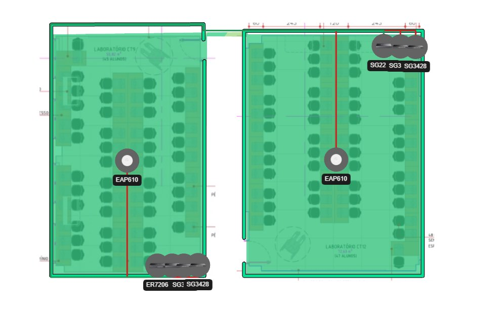
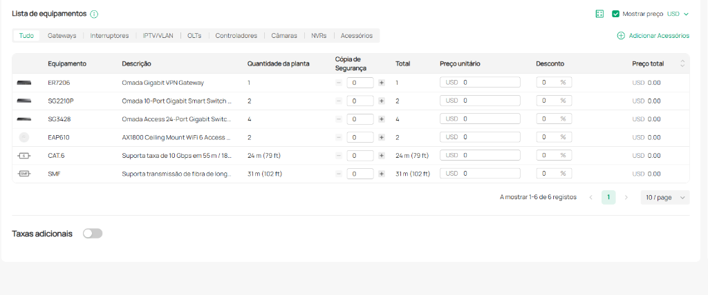
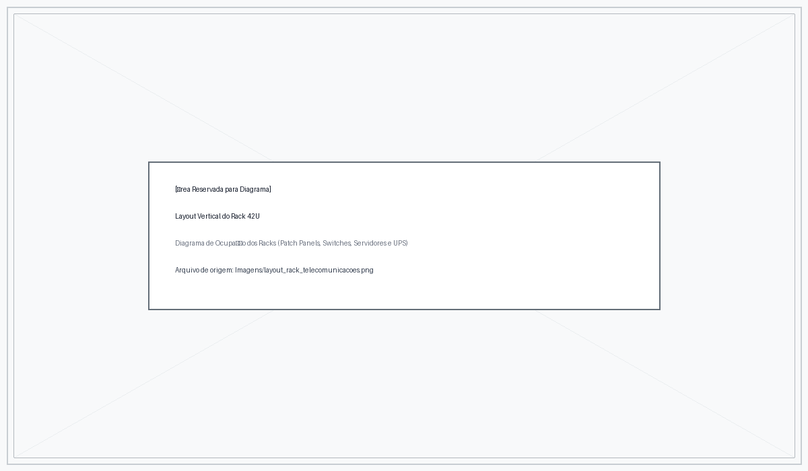

# Projeto Físico da Rede e Cabeamento Estruturado

Este documento descreve o projeto físico de infraestrutura, subsistemas de cabeamento estruturado, encaminhamento de condutos, plantas arquitetônicas consideradas, simulação de cobertura Wi-Fi no software TP-Link Omada Designer e o layout completo de ocupação vertical em escala U dos gabinetes (Racks padrão 19").

---

## 1. Plantas Arquitetônicas Consideradas

O dimensionamento físico baseia-se nas plantas baixas oficiais e cotadas dos prédios departamentais da Universidade Federal de Sergipe (UFS):

### 1.1 Laboratório CT-09 (Sala 101 - Bancadas de Pesquisa e Datacenter Local)
* **Área Total**: $55{,}82\text{ m}^2$ (dimensões de $5{,}78\text{ m} \times 9{,}47\text{ m}$);
* **Capacidade**: 45 postos de alunos/pesquisadores, mesa de coordenação e bancada de suporte;
* **Infraestrutura**: Abriga o **Rack Principal de Telecomunicações de 42U** (canto inferior direito junto à infraestrutura de energia estabilizada) e um ponto de acesso sem fio no teto (**AP-CT09**).

  
*Link para o arquivo anexado em alta resolução: [planta_CT09.png](img/planta_CT09.png)*

---

### 1.2 Laboratório CT-12 (Sala 201 - Laboratório de Geoprocessamento)
* **Área Total**: $72{,}63\text{ m}^2$ (dimensões de $7{,}26\text{ m} \times 10{,}06\text{ m}$, pé-direito de $2{,}50\text{ m}$);
* **Capacidade**: 47 postos de trabalho informatizados e mesa do docente;
* **Infraestrutura**: Abriga o **Rack Secundário de Distribuição de 24U** (canto superior direito) e um ponto de acesso sem fio no teto (**AP-CT12**).

  
*Link para o arquivo anexado em alta resolução: [planta_CT12.png](img/planta_CT12.png)*

---

## 2. Subsistemas de Cabeamento Estruturado

A instalação física abrange os prédios **CT-09** e **CT-12**, estruturando-se em cinco subsistemas normalizados (normas TIA-568 e NBR 14565):

1. **Área de Trabalho (*Work Area*)**:
   * Tomadas modulares com conectores fêmea Keystone RJ-45 Categoria 6 (250 MHz) embutidos nas calhas do mobiliário técnico;
   * Cordões de manobra (*patch cords*) conectorizados de fábrica com botas injetadas de alívio mecânico e condutores 24 AWG (1,5 m nas bancadas e 2,5 m para pontos de piso);
   * Caixas de sobrepor em teto para alimentação dos pontos de acesso Wi-Fi 6 via tecnologia PoE+ (IEEE 802.3at).

2. **Cabeamento Horizontal (*Horizontal Cabling*)**:
   * Cabos de par trançado de 4 pares não blindados (U/UTP) Categoria 6, condutores 23 AWG 100% cobre e capa com baixa emissão de fumaça e livre de halogênios (LSZH);
   * Enlace permanente (*Permanent Link*) rigorosamente limitado a 90 metros, reservando a margem de 10 metros para manobras de patch cords, respeitando o canal total de 100 metros.

3. **Infraestrutura de Encaminhamento de Cabos**:
   * Desativação total das canaletas plásticas sobrepostas precárias existentes nos laboratórios;
   * Encaminhamento aéreo principal através de **eletrocalhas perfuradas galvanizadas a fogo de $100 \times 50\text{ mm}$** com tampa sob pressão (barras de 3 metros, total de 45 metros lineares dimensionados com taxa de ocupação mecânica inferior a 40%, conforme ABNT NBR 14565 e NBR 5410);
   * Distribuição sobre as bancadas dos pesquisadores através de **canaletas técnicas de alumínio de $73 \times 25\text{ mm}$ com septo divisor interno**, garantindo a segregação física obrigatória entre circuitos elétricos e cabeamento lógico de dados;
   * Conjunto de curvas horizontais 90°, talas de emenda, tirantes roscados de fixação em laje e separação mínima de 20 cm em relação às prumadas de energia de potência, mitigando ruído e interferência eletromagnética (EMI). Todos os quantitativos e custos estão orçados nos itens 3.13 a 3.15 da planilha executiva [`NextGisWebFinal.xlsx`](../NextGisWebFinal.xlsx).

4. **Backbone de Campus em Fibra Óptica**:
   * Interligação inter-predial subterrânea entre o Prédio CT-09 e o Prédio CT-12 através de cabo óptico monomodo (*Single-Mode Fiber* - SMF) 9/125 $\mu$m com 6 fibras e proteção mecânica contra umidade e roedores;
   * Terminação em Distribuidores Internos Ópticos (DIO) padrão 19" 1U com conectores LC-UPC e transceivers SFP Gigabit Ethernet 1000BASE-LX.

5. **Salas de Telecomunicações e Gabinetes de Equipamentos**:
   * **Rack Principal (CT-09 Sala 101)**: Gabinete de piso padrão 19" $42\text{U} \times 800\text{mm} \times 1000\text{mm}$ com porta de vidro temperado e exaustão forçada, abrigando servidores, roteadores, firewall e nobreak;
   * **Rack Secundário (CT-12 Sala 201)**: Gabinete padrão 19" $24\text{U} \times 600\text{mm} \times 670\text{mm}$ para agregação local dos pontos do laboratório.

---

## 3. Planta Baixa de Infraestrutura e Lançamento de Cabos

O trajeto dos condutos, localização dos gabinetes e distribuição dos pontos de rede nos laboratórios baseiam-se nas plantas baixas arquitetônicas cotadas e na simulação no TP-Link Omada:

* [Planta Baixa Cotada - Laboratório CT-09 (Sala 101)](img/planta_CT09.png)
* [Planta Baixa Cotada - Laboratório CT-12 (Sala 201)](img/planta_CT12.png)
* [Layout Físico e Mapa de Cobertura Omada](img/omada_planta_heatmap.jpg)

### Quantitativo de Pontos por Sala

| Edifício / Sala | Finalidade Operacional | Tipo do Ponto | Quantidade |
| :--- | :--- | :--- | :---: |
| **CT-09 (Sala 101)** | Bancadas dos Pesquisadores | Keystone RJ-45 Cat6 em mobiliário | 49 |
| **CT-09 (Sala 101)** | Rede Sem Fio (Ponto 901) | Caixa de teto RJ-45 Cat6 PoE+ (1x EAP610) | 1 |
| **CT-12 (Sala 201)** | Laboratório de Geoprocessamento | Keystone RJ-45 Cat6 em mobiliário | 48 |
| **CT-12 (Sala 201)** | Rede Sem Fio (Ponto 1201) | Caixa de teto RJ-45 Cat6 PoE+ (1x EAP610) | 1 |
| **Enlace Inter-prédios**| Interligação CT-09 ao CT-12 | Fibra Óptica Monomodo 6FO | 300 m |

---

## 4. Simulação de Cobertura Eletromagnética e Mapa de Calor (TP-Link Omada)

O dimensionamento de cobertura sem fio nos laboratórios foi executado no software **TP-Link Omada Designer**, posicionando 1 ponto de acesso centralizado modelo **TP-Link Omada EAP610 (Wi-Fi 6 AX1800)** no teto de cada laboratório:

  
*Link para o arquivo anexado em alta resolução: [omada_planta_heatmap.jpg](img/omada_planta_heatmap.jpg)*

* **Resultado da Propagação RF**: Cobertura integral (100% da área útil das mesas e postos de trabalho) com nível de sinal superior a $-60\text{ dBm}$, viabilizando tráfego de alta velocidade sem áreas de sombra;
* **Canais e Frequências**: Operação em canais não sobrepostos nas faixas de 2,4 GHz (canais 1 e 6) e 5 GHz (canais 36 e 149), evitando interferência co-canal entre os prédios.

---

## 5. Lista Técnica de Equipamentos Dimensionados pelo Omada

A lista de ativos e cabos gerada pela simulação do TP-Link Omada Designer é sintetizada na tabela abaixo:

  
*Link para o arquivo anexado em alta resolução: [omada_lista_equipamentos.png](img/omada_lista_equipamentos.png)*

| Equipamento Omada | Descrição Técnica do Fabricante | Quantidade da Planta | Função na Infraestrutura |
| :--- | :--- | :---: | :--- |
| **ER7206** | Omada Gigabit VPN Gateway / Security Router | 1 | Roteamento de Borda, NAT e Firewall Perimetral (CT-09) |
| **SG2210P** | Omada 10-Port Gigabit Smart Switch PoE+ | 2 | Alimentação PoE dos Access Points (1 no CT-09 e 1 no CT-12) |
| **SG3428** | Omada Access 24-Port Gigabit L2+ Switch | 4 | Comutação e agregação de dados das bancadas (2 no CT-09 e 2 no CT-12) |
| **EAP610** | AX1800 Ceiling Mount Wi-Fi 6 Access Point | 2 | Cobertura sem fio corporativa de alta densidade (1 por sala) |
| **CAT.6** | Cabo U/UTP Cat6 23 AWG LSZH (Lançamento) | 24 m | Ramais horizontais primários calculados pelo simulador |
| **SMF** | Cabo Óptico Monomodo (Single-Mode Fiber) | 31 m | Interligação óptica direta de backbone entre os racks |

> **Nota Orçamentária**: A planilha orçamentária executiva (BOM) consolidada com cotações de atas vigentes do Portal Nacional de Contratações Públicas (PNCP, Lei nº 14.133/2021) é disponibilizada no arquivo executivo oficial [`NextGisWebFinal.xlsx`](../NextGisWebFinal.xlsx).

---

## 6. Layout e Diagrama de Ocupação dos Racks (EIA/ECA-310-E)

Esta seção consolida o detalhamento físico e a elevação vertical em escala U dos gabinetes padrão 19 polegadas dimensionados para os laboratórios nos prédios **CT-09 (Sala 101)** e **CT-12 (Sala 201)** da Universidade Federal de Sergipe.

---

### 6.1 Rack Principal de Telecomunicações e Servidores (42U - CT-09 Sala 101)

* **Gabinete**: Rack fechado de piso autossustentado $42\text{U} \times 800\text{mm} \times 1000\text{mm}$ com porta de vidro temperado fumê e fechadura com chave;
* **Localização**: Laboratório CT-09 (Sala 101), posicionado no canto inferior direito junto à infraestrutura de energia estabilizada;
* **Finalidade**: Concentrar os ativos de borda e segurança, roteamento inter-VLAN, switches de agregação, servidores corporativos do sistema CKAN, armazenamento em rede (NAS) e sistema de alimentação ininterrupta.

```text
=============================================================================
                      SISTEMA DE EXAUSTÃO (TETO DO RACK)
=============================================================================
[U42] [======================= PAINEL DE VENTILAÇÃO =======================]
[U41] [=================== CALHA DE TOMADAS (PDU) 12T =====================]
[U40] [=================== ROTEADOR / FIREWALL BORDA (ER7206) =============]
[U39] [----------------- GUIA DE CABO HORIZONTAL 1U -----------------------]
[U38] [=================== FIREWALL PERIMETRAL FÍSICO (ASA 5506-X) ========]
[U37] [----------------- GUIA DE CABO HORIZONTAL 1U -----------------------]
[U36] [=================== ROTEADOR INTERNO INTER-VLAN (CISCO 2911) =======]
[U35] [----------------- GUIA DE CABO HORIZONTAL 1U -----------------------]
[U34] [=================== SWITCH CORE / AGREGAÇÃO (SG3428 24P) ===========]
[U33] [----------------- GUIA DE CABO HORIZONTAL 1U -----------------------]
[U32] [================== PATCH PANEL 01 (DATACENTER CKAN) ================]
[U31] [----------------- GUIA DE CABO HORIZONTAL 1U -----------------------]
[U30] [================== SWITCH DE ACESSO 01 POE+ (SG2210P) ==============]
[U29] [----------------- GUIA DE CABO HORIZONTAL 1U -----------------------]
[U28] [================ PATCH PANEL 02 (ESTRUTURADO CT-09 BLOCO A) ========]
[U27] [----------------- GUIA DE CABO HORIZONTAL 1U -----------------------]
[U26] [================== SWITCH DE ACESSO 02 (SG3428 DADOS) ==============]
[U25] [----------------- GUIA DE CABO HORIZONTAL 1U -----------------------]
[U24] [================ PATCH PANEL 03 (ESTRUTURADO CT-09 BLOCO B) ========]
[U23] [----------------- GUIA DE CABO HORIZONTAL 1U -----------------------]
[U22] [====================== ESPAÇO VAGO / RESERVA ======================]
[U21] [====================== ESPAÇO VAGO / RESERVA ======================]
[U20] [====================== ESPAÇO VAGO / RESERVA ======================]
[U19] [================== DIO (DISTRIBUIDOR INTERNO ÓPTICO 24F) ===========]
[U18] [----------------- GUIA DE CABO HORIZONTAL 1U -----------------------]
[U17] [=================== BANDEJA FIXA DE TI (1U) ========================]
[U16] [====================== ESPAÇO VAGO / RESERVA ======================]
[U15] [======== SERVIDOR DHCP DEDICADO DELL POWEREDGE R250 (1U) ===========]
[U14] [----------------- GUIA DE CABO HORIZONTAL 1U -----------------------]
[U13] [======== SERVIDOR WEB CKAN PORTAL DELL POWEREDGE R440 (1U) =======]
[U12] [----------------- GUIA DE CABO HORIZONTAL 1U -----------------------]
[U11] [  NAS / STORAGE BACKUP 4 BAIAS 16TB RAID 5 (QNAP)                   ] (2U)
[U10] [____________________________________________________________________]
[U09] [  SERVIDOR BANCO POSTGIS DELL POWEREDGE R540 2U (128GB/SAS)         ] (2U)
[U08] [____________________________________________________________________]
[U07] [====================== ESPAÇO VAGO / RESERVA ======================]
[U06] [====================== ESPAÇO VAGO / RESERVA ======================]
[U05] [====================== ESPAÇO VAGO / RESERVA ======================]
[U04] [  BANCO DE BATERIAS EXTERNO (EXPANSÃO DE AUTONOMIA 2U)              ] (2U)
[U03] [____________________________________________________________________]
[U02] [  NO-BREAK (UPS) SENOIDAL ONLINE DUPLA CONVERSÃO 3000VA (2U)        ] (2U)
[U01] [____________________________________________________________________]
=============================================================================
                           BASE DO RACK / RODÍZIOS
=============================================================================
::: ORGANIZADORES LATERAIS :::
(Passam verticalmente da base ao topo nas laterais esquerda e direita)
```

  
*Link para o anexo em alta resolução: [layout_rack_telecomunicacoes.png](img/layout_rack_telecomunicacoes.png)*

> **Nota sobre o Roteador Provedor (`ISP-UFS`)**: O roteador de borda da operadora situa-se no datacenter central do Núcleo de Tecnologia da Informação (NTI/UFS), não ocupando espaço físico no rack local do laboratório.

---

### 6.2 Rack Secundário de Distribuição Local (24U - CT-12 Sala 201)

* **Gabinete**: Mini-Rack padrão 19" $24\text{U} \times 600\text{mm} \times 670\text{mm}$ de piso/parede com porta de vidro e fechadura;
* **Localização**: Laboratório CT-12 (Sala 201), posicionado no canto superior direito;
* **Finalidade**: Realizar a terminação do enlace óptico inter-predial, comutação local dos postos de trabalho e alimentação PoE do Access Point EAP610.

```text
=============================================================================
                      SISTEMA DE VENTILAÇÃO (TETO DO RACK)
=============================================================================
[U24] [======================= PAINEL DE VENTILAÇÃO =======================]
[U23] [=================== CALHA DE TOMADAS (PDU) 8T ======================]
[U22] [================== DIO (DISTRIBUIDOR INTERNO ÓPTICO 24F) ===========]
[U21] [----------------- GUIA DE CABO HORIZONTAL 1U -----------------------]
[U20] [================= SWITCH DE ACESSO 01 (SG3428 24P GBE) =============]
[U19] [----------------- GUIA DE CABO HORIZONTAL 1U -----------------------]
[U18] [================ PATCH PANEL 01 (ESTRUTURADO CT-12 BLOCO A) ========]
[U17] [----------------- GUIA DE CABO HORIZONTAL 1U -----------------------]
[U16] [================= SWITCH DE ACESSO 02 (SG3428 24P GBE) =============]
[U15] [----------------- GUIA DE CABO HORIZONTAL 1U -----------------------]
[U14] [================ PATCH PANEL 02 (ESTRUTURADO CT-12 BLOCO B) ========]
[U13] [----------------- GUIA DE CABO HORIZONTAL 1U -----------------------]
[U12] [================== SWITCH DE ACESSO 03 POE+ (SG2210P) ==============]
[U11] [----------------- GUIA DE CABO HORIZONTAL 1U -----------------------]
[U10] [=================== BANDEJA FIXA DE APOIO (1U) =====================]
[U09] [====================== ESPAÇO VAGO / RESERVA ======================]
[U08] [====================== ESPAÇO VAGO / RESERVA ======================]
[U07] [====================== ESPAÇO VAGO / RESERVA ======================]
[U06] [====================== ESPAÇO VAGO / RESERVA ======================]
[U05] [====================== ESPAÇO VAGO / RESERVA ======================]
[U04] [====================== ESPAÇO VAGO / RESERVA ======================]
[U03] [====================== ESPAÇO VAGO / RESERVA ======================]
[U02] [  NO-BREAK (UPS) SENOIDAL INTERATIVO 1500VA RACKMOUNT (2U)           ] (2U)
[U01] [____________________________________________________________________]
=============================================================================
                           BASE DO RACK / FIXAÇÃO
=============================================================================
::: ORGANIZADORES LATERAIS DE CABOS :::
```

---

### 6.3 Critérios Técnicos de Engenharia e Boas Práticas

1. **Distribuição Gravitacional de Cargas**:
   * O sistema de nobreak e os módulos de baterias (elementos mais pesados do conjunto, totalizando mais de 60 kg) foram alocados na base inferior ([U01] a [U04]) para rebaixar o centro de gravidade e prevenir instabilidades estruturais do gabinete;
   * Os servidores de processamento e armazenamento (Dell PowerEdge e QNAP) ocupam o terço médio inferior ([U08] a [U15]);
   * Equipamentos ativos de rede leves e painéis de manobra ocupam a porção superior ([U24] a [U42]).

2. **Termodinâmica e Fluxo de Ar (*Airflow*)**:
   * Todos os equipamentos adotam o padrão de refrigeração frontal-traseira (*Front-to-Back Airflow*);
   * Os espaços vagos foram mantidos para evitar acúmulo de ar quente residual entre as lâminas de processamento;
   * O topo do gabinete é equipado com sistema de exaustão forçada com ventiladores acionados por termostato regulado para $24^\circ\text{C}$.

3. **Gerenciamento e Manutenibilidade de Cabos**:
   * Aplicação da regra 1:1 (um organizador horizontal de cabos 1U para cada elemento de manobra ou ativo comutador);
   * Manobras estruturadas com cordões de tamanho padronizado (0,5 m e 1,5 m), eliminando laços suspensos e obstrução visual das portas de diagnóstico.
