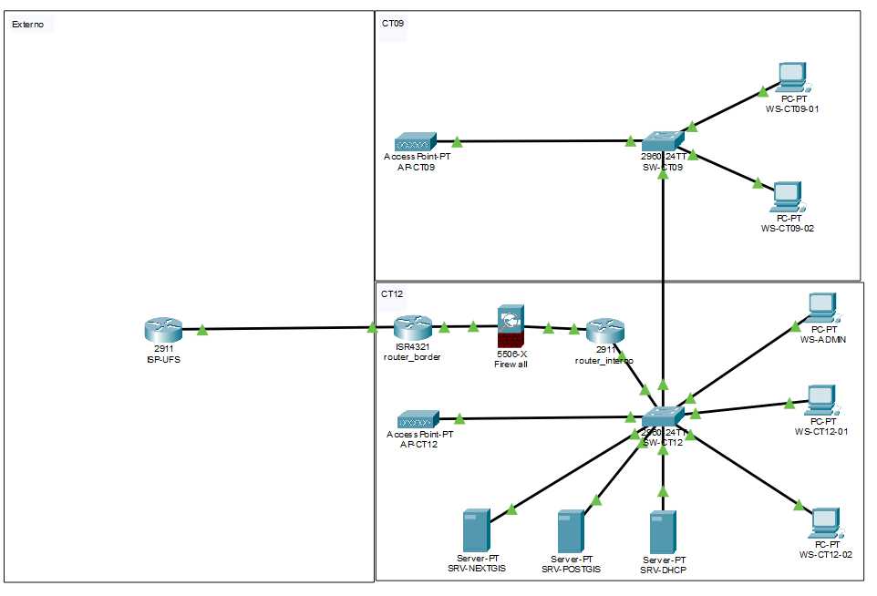
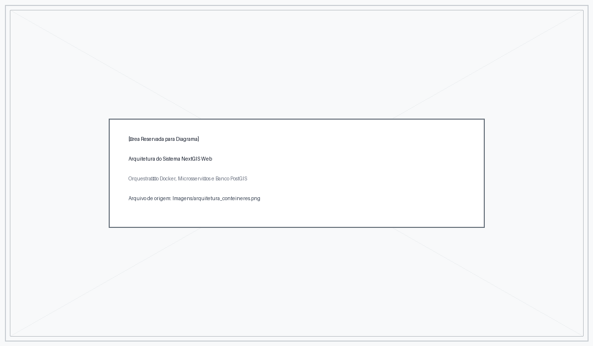

# Projeto Lógico da Rede de Computadores

Este documento detalha o projeto lógico da infraestrutura corporativa do laboratório, estruturado segundo o modelo hierárquico em três camadas, com segmentação virtual (VLANs), segurança perimetral, roteamento inter-VLAN e políticas de controle de acesso.

---

## 1. Diagrama de Arquitetura de Rede em Três Camadas

A topologia lógica é agnóstica à localização física dos prédios, estruturando-se estritamente por funções de rede para conter falhas de difusão (*broadcast*), isolar dados sensíveis e padronizar políticas de segurança.


*Link para o arquivo anexado em alta resolução: [topologia_logica.png](img/topologia_logica.png)*

A arquitetura organiza-se nas seguintes camadas:

1. **Camada de Borda e Segurança Perimetral (*Edge & Security*)**:
   * **Roteador de Borda (`router_border` - Cisco ISR 4321)**: Interconecta a rede corporativa ao link WAN da universidade (`ISP-UFS` na sub-rede `200.17.0.0/30`), realizando tradução de endereços por sobrecarga (*NAT Overload*);
   * **Firewall Físico (`Firewall` - Cisco ASA 5506-X)**: Posicionado entre a borda externa e o núcleo da rede. Estabelece zonas com níveis de segurança distintos (*outside* com nível 0 e *inside* com nível 100), inspecionando fluxos de estado via *Modular Policy Framework* (MPF) para ICMP, HTTP e DNS.

2. **Camada de Núcleo e Distribuição (*Core & Distribution*)**:
   * **Roteador Interno (`router_interno` - Cisco 2911)**: Centraliza o roteamento entre as sub-redes virtuais por meio de subinterfaces 802.1Q (*Router-on-a-Stick*). Aplica listas de controle de acesso (ACL) estendidas e opera como agente de retransmissão (*DHCP Relay Agent* via `ip helper-address`), repassando as requisições de clientes para o servidor DHCP dedicado.

3. **Camada de Acesso e Serviços (*Access & Services*)**:
   * **Switches de Camada 2 (Cisco Catalyst 2960-24TT)**: Conectam os dispositivos finais com marcação de quadros 802.1Q;
   * **Servidores Dedicados (DMZ / VLAN 20)**: Hospedam os nós de serviço `SRV-NEXTGIS` (aplicação web), `SRV-POSTGIS` (banco de dados espacial) e `SRV-DHCP` (concessão de endereçamento IP);
   * **Estações de Trabalho de Usuários (VLAN 30)**: Estações de pesquisa técnica e estação autorizada de administração `WS-ADMIN`;
   * **Rede Sem Fio (VLAN 40)**: Pontos de acesso Wi-Fi 6 corporativos (`AP-CT12` e `AP-CT09`).

---

## 2. Plano de Endereçamento IP e Alocação de VLANs

A infraestrutura utiliza blocos privados de endereçamento (RFC 1918) divididos em 4 Redes Locais Virtuais (VLANs) e sub-redes ponto a ponto (/30) para enlaces de trânsito:

| VLAN / Enlace | Nome da Rede | Sub-rede (CIDR) | Gateway Padrão | Finalidade Operacional |
| :---: | :--- | :--- | :--- | :--- |
| **VLAN 10** | Gerência de Ativos | `192.168.10.0/24` | `192.168.10.1` | Gerenciamento exclusivo de switches e roteadores |
| **VLAN 20** | Servidores e DMZ | `192.168.20.0/24` | `192.168.20.1` | Serviços NextGIS Web, banco PostGIS e DHCP |
| **VLAN 30** | Estações de Usuários | `192.168.30.0/24` | `192.168.30.1` | Computadores de pesquisa e estação administrativa |
| **VLAN 40** | Rede Sem Fio (Wi-Fi) | `192.168.40.0/24` | `192.168.40.1` | Dispositivos móveis e notebooks via Access Points |
| **Enlace WAN** | Trânsito Provedor UFS | `200.17.0.0/30` | `200.17.0.1` | Enlace WAN entre `ISP-UFS` e `router_border` |
| **Ponto a Ponto**| WAN-Firewall | `10.0.0.0/30` | `10.0.0.1` | Interconexão entre `router_border` e interface *outside* do ASA |
| **Ponto a Ponto**| Firewall-Núcleo | `10.0.1.0/30` | `10.0.1.1` | Interconexão entre interface *inside* do ASA e `router_interno` |
| **Loopback** | Teste DNS / Internet | `8.8.8.8/32` | `8.8.8.8` | Resolução DNS e teste público simulado |

### Mapeamento Estático e Dinâmico de Endereços

* **VLAN 10**: IPs estáticos para switches (`192.168.10.2` e `192.168.10.3`) e Access Points (`192.168.10.11` e `192.168.10.12`);
* **VLAN 20**: IPs estáticos para `SRV-NEXTGIS` (`192.168.20.10`), `SRV-POSTGIS` (`192.168.20.20`) e `SRV-DHCP` (`192.168.20.30`);
* **VLAN 30**: Atribuição dinâmica via `SRV-DHCP` na faixa de `192.168.30.50` a `192.168.30.200`, com exceção da estação de administração `WS-ADMIN` (`192.168.30.10` estático);
* **VLAN 40**: Atribuição dinâmica via `SRV-DHCP` na faixa de `192.168.40.50` a `192.168.40.250`.

---

## 3. Matriz de Fluxo de Tráfego e Regras de Firewall (ACLs)

As políticas de segurança corporativa implementam o princípio do menor privilégio, restringindo acessos entre as sub-redes e garantindo o isolamento da camada de dados:

| Origem | Destino | Protocolo / Porta | Ação | Justificativa Técnica |
| :--- | :--- | :---: | :---: | :--- |
| **VLAN 30 / 40** | `any` | UDP 67, 68 (DHCP) | **PERMIT** | Permite negociação e renovação de concessões DHCP |
| **VLAN 30 / 40** | `SRV-NEXTGIS` (`192.168.20.10`) | TCP 80, 443 | **PERMIT** | Acesso web à interface de mapas e catálogo OGC |
| **VLAN 30 / 40** | `SRV-POSTGIS` (`192.168.20.20`) | TCP 5432 | **DENY** | Bloqueia acesso direto ao PostgreSQL (proteção do banco) |
| **VLAN 30 / 40** | VLAN 10 (Gerência) | Todos | **DENY** | Impede que estações acessem consoles de switches/roteadores |
| `WS-ADMIN` (`192.168.30.10`) | VLAN 10 (Gerência) | TCP 22 (SSH) | **PERMIT** | Permite gestão técnica autorizada dos ativos |
| **VLAN 30 / 40** | Internet / WAN | Todos | **PERMIT** | Saída para a Internet via inspeção no ASA e NAT no ISR 4321 |
| **Zona Externa (*Outside*)** | Rede Interna (*Inside*) | Todos | **DENY** | Bloqueio de conexões iniciadas externamente sem estado |

### Implementação da Lista de Controle de Acesso no Cisco IOS

Configuração aplicada na subinterface `g0/0.30` do roteador de distribuição:

```cisco
ip access-list extended ACL_PESQUISA_IN
 permit udp any any eq bootpc
 permit udp any any eq bootps
 permit tcp 192.168.30.0 0.0.0.255 host 192.168.20.10 eq 80
 permit tcp 192.168.30.0 0.0.0.255 host 192.168.20.10 eq 443
 deny   tcp 192.168.30.0 0.0.0.255 host 192.168.20.20 eq 5432 log
 deny   ip 192.168.30.0 0.0.0.255 192.168.10.0 0.0.0.255
 permit ip 192.168.30.0 0.0.0.255 any
!
interface GigabitEthernet0/0.30
 encapsulation dot1Q 30
 ip address 192.168.30.1 255.255.255.0
 ip helper-address 192.168.20.30
 ip access-group ACL_PESQUISA_IN in
```

---

## 4. Arquitetura do Serviço de Software Livre

A plataforma geoespacial foi concebida sob o ecossistema de software de código aberto:


*Link para o arquivo anexado em alta resolução: [arquitetura_conteineres.png](img/arquitetura_conteineres.png)*

1. **Proxy Reverso e Cache Web**: Nginx atuando como ponto único de entrada HTTP/HTTPS (portas 80 e 443), aplicando compactação gzip, cache de recursos estáticos e proteção de cabeçalhos;
2. **Servidor de Mapas (*Core*)**: NextGIS Web processando chamadas da API REST e requisições OGC (WMS/WFS/TMS);
3. **Fila de Tarefas Assíncronas**: Redis 7.2 gerenciando filas de importação pesada de camadas cartográficas e geração de pirâmides de mosaicos;
4. **Sistema Gerenciador de Banco de Dados**: PostgreSQL 16 com extensão espacial PostGIS 3.4, garantindo armazenamento transacional com suporte a tipos geométricos, operações topológicas e indexação R-Tree (GIST).
